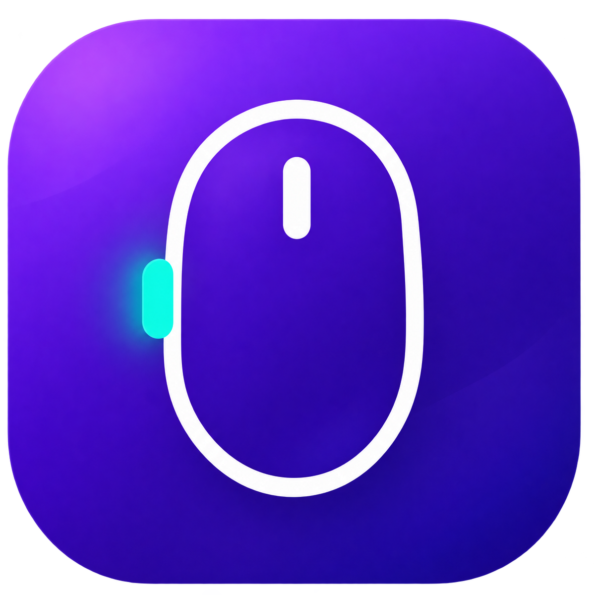

# MouseQuickSwitch 使用教程



MouseQuickSwitch 是 macOS 菜单栏工具：可分别配置两个鼠标侧键，让每个侧键 **切换到上一个程序（⌘Tab）** 或 **切换到指定程序**；也可在指定程序中设置最多三组键盘按键映射。适用于 macOS 13 及更新版本的 Apple silicon 和 Intel Mac。以下教程对应仓库中的 0.6.0 版本。

## 1. 安装并启动

要使用本教程中的 0.6.0 界面，请先安装 Xcode 或 Xcode Command Line Tools，在仓库目录运行：

```sh
./scripts/build-app.sh
open build/MouseQuickSwitch.app
```

程序只显示在菜单栏，不显示在 Dock。目前公开的[未公证预览版 DMG](https://github.com/tedeyang/MouseQuickSwitch/releases/tag/v0.3.1-preview.1) 仍是 0.3.1，不包含键盘映射和新的设置界面。

如果 macOS 阻止预览版启动，在“系统设置 → 隐私与安全性”找到被阻止的应用并选择允许，然后重新打开。预览版供测试使用；当前没有经过 Developer ID 签名和 Apple 公证的正式安装包。

首次启动后，设置窗口会先显示权限引导。**在授权前，程序无法检测或拦截侧键点击。**先在“系统设置 → 隐私与安全性 → 辅助功能”中允许 MouseQuickSwitch；如果窗口仍显示无法监听，再到“输入监控”中允许它。点击授权后，系统窗口会显示在设置窗口前面；完成授权并离开系统设置后，程序会带你回到设置窗口。如系统要求退出并重新打开应用，设置窗口会恢复。看到“鼠标权限已就绪”后再设置侧键。重新构建预览版后，macOS 可能要求再次授权。

## 2. 选择界面语言

菜单分为 **鼠标按键** 和 **键盘映射** 两组。鼠标按键分区列出 **侧键 1** 和 **侧键 2**，点击各自的子菜单可修改动作、目标程序和启用状态；底部是 **语言** 和退出。**语言（Language）** 默认选中 **跟随系统（Follow System）**：系统首选语言为中文时显示简体中文，其他语言显示英文。可随时改选 **简体中文** 或 **English**，菜单和应用提示会立即切换；手动选择会在下次启动时保留。

## 3. 设置侧键

首次使用会打开设置窗口；之后可从菜单栏选择 **设置鼠标按键…** 再次打开。窗口顶部先选 **侧键 1** 或 **侧键 2**，再为这一组选择鼠标上的实体按键和动作。设置完第一组后切到第二组，重复操作。旧版保存的侧键配置会保留为 **侧键 1**。

如果程序识别到 M585，可直接为两组分别点 **后退键** 和 **前进键**，跳过录制；同一实体按键不能同时分配给两组。然后试按侧键：窗口会显示检测到的按键，示意图也会高亮对应侧键。接收器或驱动可能改变设备名称、按键编号；若没有识别到型号，或快捷选择不正确，点 **按下侧键录制…**，再按一下要使用的侧键即可。录制时可随时取消。

## 4. 选择按键动作

**切换到上一个程序：** 每次按该侧键会模拟 ⌘Tab，在最近使用的两个程序之间切换。也可从菜单栏对应侧键的子菜单选择。

**切换到指定程序：** 点设置窗口中的 **选择要切到的程序…** 选取一个 `.app`；也可从菜单栏对应侧键的子菜单点 **选择程序…**。每次按该侧键，程序会启动或切到这个程序。两组侧键可以选择不同的目标程序。

确认每组的 **启用此侧键** 已打开。此时被映射的按键原本的前进或后退动作会被拦截。

每组侧键只能选一种动作。设置窗口打开时，侧键用于检查检测结果；关闭窗口后才会执行所选动作。

## 5. 暂停、恢复与退出

- 在设置窗口或菜单中关闭对应侧键的 **启用此侧键**，可单独暂停或恢复这一组映射；暂停期间该按键执行原本的动作。
- 选择 **退出 MouseQuickSwitch（Quit MouseQuickSwitch）** 可退出，侧键恢复原本的动作。
- 按键、动作和目标应用会保存在本机，下次启动继续使用。

## 6. 设置键盘按键映射

1. 在菜单栏选择 **设置键盘按键…**，点击 **选择程序…**，选定映射生效的 `.app`。映射只在这个程序位于最前方时生效。
2. 在 **映射 1** 中点击 **录制源键**，按一下要替换的按键；再点击 **录制目标键**，按一下要输出的按键。例如先录制 **空格**，再录制 **↓**，即在选定程序中把空格键变为向下方向键。
3. 如需更多映射，点击 **添加映射**，最多三组。每组可用右侧的叉号清除；同一个源按键不能重复使用。
4. 确认按键与目标程序后，打开 **启用键盘映射**。菜单栏的 **键盘映射** 分区会显示目标程序、已设置的组数和同名开关，可随时暂停；键盘映射默认关闭。

这里录制的是单个普通按键，不能把 ⌘、⌥、⌃、⇧ 单独录为映射，也不支持录制组合键；带这些修饰键的快捷键仍保持原有行为。录制和映射需要系统授权键盘输入访问；若窗口提示权限不足，请按提示授权，再回到设置窗口继续。程序仅在本机保存按键编号和所选程序，不记录输入的文字。

## 遇到问题

| 现象 | 处理方法 |
| --- | --- |
| 菜单显示权限不足，或按键没有反应 | 在“系统设置 → 隐私与安全性”检查辅助功能和输入监控权限，重新启动应用，再尝试录制。 |
| 键盘映射没有生效 | 检查目标程序是否在最前方、源键和目标键是否都已录制，以及 **启用键盘映射** 是否打开。 |
| 侧键已设置，但没有切到指定程序 | 检查对应侧键的 **启用此侧键** 是否勾选、是否选了 **切换到指定程序**，以及所选程序是否正确。 |
| 其他鼠标的侧键也触发了映射 | 程序只能识别鼠标按钮编号，不能区分鼠标型号；同编号的按键也会触发。 |
| M585 的设备切换键无法录制 | Easy-Switch 设备切换键和只发送厂商专有 HID 事件的按键不受支持。 |

从旧版 mouseQuick 或 MousePlus 升级时，首次启动会迁移已保存的设置；仍需为 MouseQuickSwitch 单独授予权限。

## 开发者：制作 DMG

要生成本地测试 DMG，运行 `./scripts/package-dmg.sh`。需要发布正式 DMG 时，先配置 Developer ID Application 证书和 `notarytool` 钥匙串凭据，再运行：

```sh
CODESIGN_IDENTITY='Developer ID Application: Your Name (TEAMID)' \
NOTARY_PROFILE='mousequickswitch' ./scripts/package-dmg.sh
```

脚本只在 Apple 接受公证并成功附加票据后生成正式文件。

## 给 Agent 的本机安装提示词

将下面这段话交给能访问本机终端的 Agent，可让它从当前仓库安装最新源码版本：

```text
请在 MouseQuickSwitch 仓库中安装本机最新版。先检查工作区状态并保留现有修改，运行 ./scripts/build-app.sh 构建通用 macOS 应用，确认 arm64、x86_64 架构和代码签名。读取构建产物 Info.plist 中的版本号，备份现有 /Applications/MouseQuickSwitch.app，停止正在运行的旧版，然后把 build/MouseQuickSwitch.app 安装到 /Applications/MouseQuickSwitch.app。安装后核对版本、签名和可执行文件与构建产物一致，并尝试启动。不要清除用户偏好设置，也不要自动授予系统权限；若无法启动或需要授权，明确告诉我需要手动完成的步骤。最后报告实际安装版本和验证结果。
```
